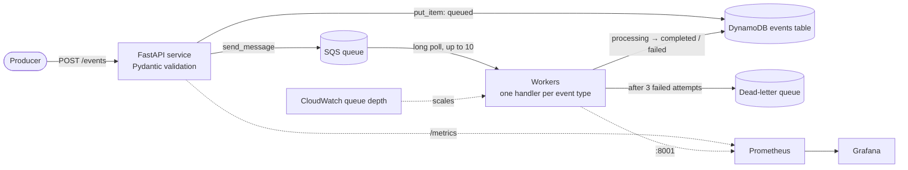

# Event-Processing Platform

An ingest, validate and route pipeline: events come in over HTTP, are validated at the boundary, queued, and processed by workers that retry and dead-letter instead of dropping data.

[](https://github.com/samarthpaliwal/event-processing-platform/actions/workflows/ci.yml)


<!-- TODO: add a Grafana screenshot. Capture steps are in docs/README.md.

-->

## Problem

An ingest service has two ways to lose data: accept a malformed record and fail on it later, or let one
slow or failing consumer stall everything queued behind it. The producer should get a fast answer, bad
input should be rejected before it enters the system, and a failing event should end up somewhere it can
be inspected rather than disappearing.

## Approach



- **Validate at the boundary.** `POST /events` checks the body against a Pydantic model, assigns a UUID,
  writes the event to SQS and records it in DynamoDB as `queued`. The caller polls
  `GET /events/{event_id}` for `queued → processing → completed`.
- **Retry, then park.** A worker long-polls SQS, runs the handler for the event type, and on an exception
  retries in-process three times with 1, 2 and 4 second backoff. After that it marks the event `failed`,
  copies the body to the dead-letter queue and deletes the original. The queue also has a redrive policy
  to the DLQ after three receives.
- **Stop cleanly.** `SIGTERM` and `SIGINT` set a flag, so a worker finishes its current batch before exiting.
- **Scale on backlog.** Terraform defines two auto-scaling groups behind an ALB: API 2 to 10 instances,
  workers 3 to 20. Workers scale out by 2 when visible messages stay above 1,000 for 2 minutes and scale
  in by 1 when they stay below 100 for 10 minutes.
- **Observe.** The API and each worker export Prometheus counters and latency histograms; a Grafana
  dashboard definition is in `monitoring/`.

## Results

- 5 unit tests pass in CI: three for the API with SQS and DynamoDB mocked (submit, health, metrics) and
  two for the processor (handler result, idempotency).
- No load-test report is committed, so this README quotes no throughput figure. `scripts/load-test.sh`
  runs the Locust profile in `load-testing/` and writes `load-testing/report.html`.

Known limits: the handlers in `worker/processor.py` are stand-ins that sleep for a short random time and
return a small result, each worker processes one event at a time, and the idempotency cache is an
in-process dictionary that is not shared between workers.

## Quick start

Requires Docker with Compose, and Python 3.9 with `pip`.

```bash
git clone https://github.com/samarthpaliwal/event-processing-platform.git
cd event-processing-platform
./scripts/local-setup.sh              # starts LocalStack, creates the two queues and the table
docker compose up --scale worker=3    # API :8000, workers, Prometheus :9090, Grafana :3000
```

Submit an event and follow it:

```bash
curl -X POST http://localhost:8000/events \
  -H "Content-Type: application/json" \
  -d '{"event_type": "analytics", "payload": {"data_points": 500}}'
```

```bash
curl http://localhost:8000/events/<event_id>
```

`GET /stats` returns queue depth and in-flight count. Grafana's login is `admin` / `admin`.

Run the tests (no Docker or AWS needed):

```bash
pip install -r api/requirements.txt -r worker/requirements.txt -r requirements-dev.txt
pytest
```

Load test:

```bash
./scripts/load-test.sh http://localhost:8000 1000 50 10m   # host, users, spawn rate, duration
```

Deploy to AWS:

```bash
cd infrastructure/terraform && terraform init && terraform apply
```

The `Deploy` workflow does the same from GitHub (image build, push to ECR, `terraform apply`). It runs
only when started by hand and needs the `AWS_ACCESS_KEY_ID` and `AWS_SECRET_ACCESS_KEY` repository secrets.

## Configuration

Both services read environment variables. `docker-compose.yml` sets them for LocalStack and
`infrastructure/terraform/user_data_*.sh` set them on EC2.

| Variable | Used by | Purpose |
|---|---|---|
| `AWS_REGION` | api, worker | AWS region (default `us-east-1`) |
| `AWS_ACCESS_KEY_ID`, `AWS_SECRET_ACCESS_KEY` | api, worker | Credentials (`test` / `test` for LocalStack) |
| `AWS_ENDPOINT_URL` | api, worker | `http://localstack:4566` locally; unset on AWS |
| `SQS_QUEUE_URL` | api, worker | Main queue URL |
| `SQS_DLQ_URL` | worker | Dead-letter queue URL |
| `DYNAMODB_TABLE_NAME` | api, worker | Events table (default `events`) |
| `WORKER_ID` | worker | Label for logs (default `worker-<pid>`) |
| `WORKER_METRICS_PORT` | worker | Prometheus port (default `8001`) |

## Tech stack

Python 3.9, FastAPI, Pydantic, boto3, AWS SQS and DynamoDB, Docker Compose, LocalStack, Terraform,
Prometheus, Grafana, Locust, pytest, GitHub Actions.

## Project structure

```
event-processing-platform/
├── api/app.py                  FastAPI service: /events, /stats, /health, /metrics
├── worker/
│   ├── worker.py               SQS consumer loop, retries, DLQ, metrics
│   └── processor.py            per-event-type handlers, in-memory idempotency cache
├── infrastructure/
│   ├── docker/                 Dockerfile.api, Dockerfile.worker
│   └── terraform/              VPC, SQS + DLQ, DynamoDB, ALB, auto-scaling groups, alarms
├── monitoring/                 prometheus.yml, grafana-dashboard.json
├── load-testing/locustfile.py
├── tests/                      test_api.py, test_worker.py
├── scripts/                    local-setup.sh, load-test.sh, setup.sh
├── docker-compose.yml          localstack, api, worker, prometheus, grafana
└── .github/workflows/          ci.yml (tests), deploy.yml (manual)
```
